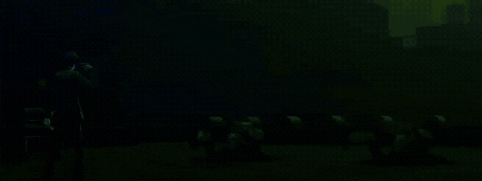
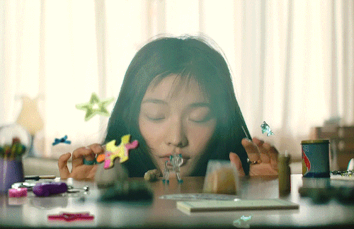
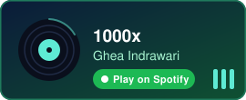
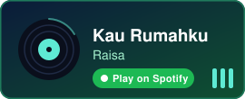
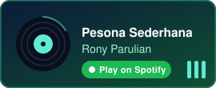

<h1 align="center"> N1vervic/Muhammad Hanif Farhan </h1>

  

  
  

  

       

 
   
  
  

  

  <h1> 👋 About Me</h1>
    
  

  
Muhammad Hanif Farhan, a Statistics student at Institut Teknologi Sepuluh Nopember. I previously studied Information Technology (Vocational Program) at Universitas Brawijaya. I enjoy exploring new things to learn—ranging from how to play games to how to create animations (though I still haven't quite mastered that last one yet :p).

  
I am currently interning as a Control Sub-division Programmer at Barunastra and undergoing training as a Marketing Consultant at 180DC ITS. You might be wondering why they’re so different, right? Well, that’s exactly the point, I really enjoy learning new things.

  

    
  

 

  

  <h1>STATS</h1>
    
  

    
    
  

  

  <h1>Favorite Song</h1>
    
  

    
    
    
  

  

  <h1>Are you done?</h1>
    
  
Well, we've reached the end. But before you go, feel free to visit my social media profiles.

  

    
    
    
    
    
    
    
    
    

  <h1>👋 Thank Youu 👋
  

    
  

